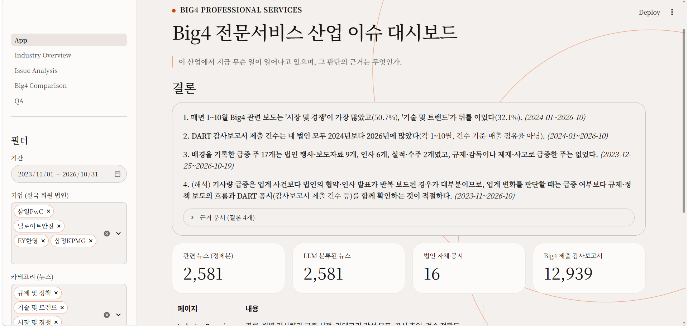
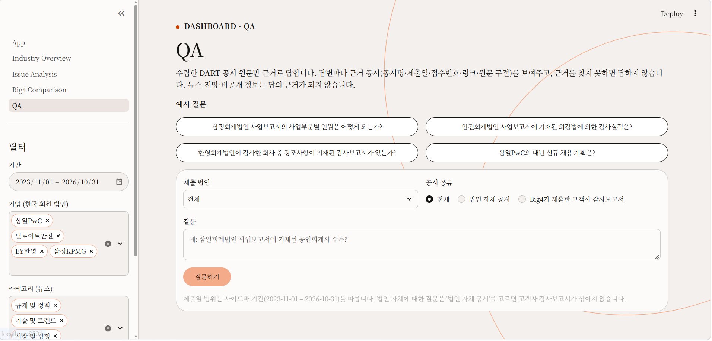
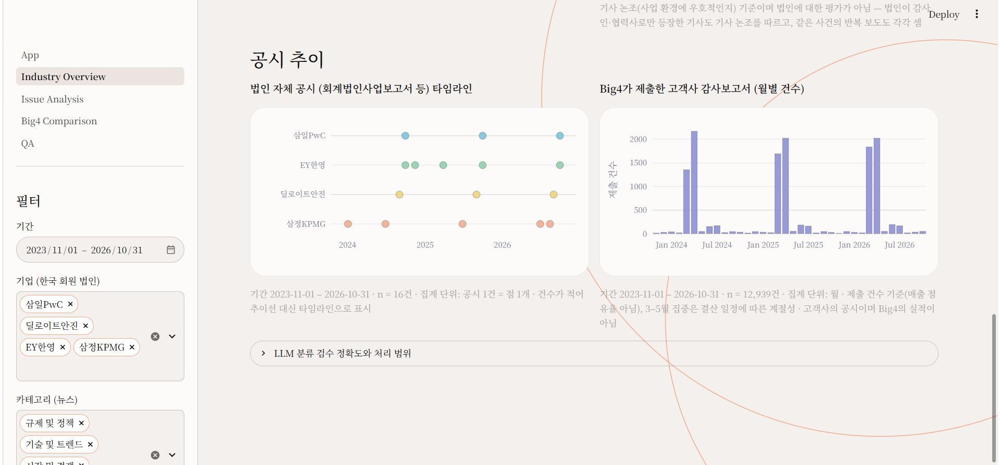
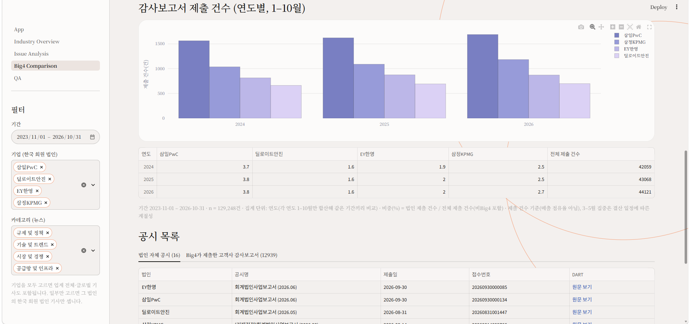

# Big4 Industry Intelligence

PwC · Deloitte · EY · KPMG(및 한국 회원 법인)의 뉴스와 DART 공시를 분석해
**"이 산업에서 지금 무슨 일이 일어나고 있으며, 그 판단의 근거는 무엇인가"** 에 답하는 Streamlit 대시보드.

## 한눈에 보기

- **사용자:** Big4 동향을 보는 업계 실무자. 지금 무엇이 보도되는지 빠르게 보고, 궁금한 사실은 공시 원문 근거로 확인한다.
- **대상·기간:** 삼일PwC · 딜로이트안진 · EY한영 · 삼정KPMG(및 글로벌 네트워크), 2023-11 \~ 2026-10
- **역할 분리:** 뉴스는 변화 탐색, DART 공시는 사실 확인. LLM 분류·요약·임베딩은 배치로 미리 만들어 저장하고,
  대시보드는 저장된 결과만 읽는다(실시간 LLM 호출은 공시 Q&A 한 곳).

### 기술 스택

| 영역 | 사용 |
|---|---|
| 언어·데이터 | Python, pandas, SQLite |
| 수집 | DART OpenAPI, 네이버 검색 API (requests) |
| LLM | OpenAI `gpt-6-luna` — 뉴스 분류·이슈 추출, 결론 초안, 분기별 이슈 요약, 공시 Q&A 답변·리랭킹 |
| RAG | `text-embedding-3-large`, Chroma(LangChain), BM25(글자 2-gram) + RRF 결합, LLM 리랭킹 |
| 대시보드 | Streamlit, Plotly |
| 테스트 | pytest (외부 API 없이 실행, 계층 간 import 규칙 검사 포함) |

### 핵심 발견 (두 사람이 근거 문서와 대조해 확정, 리포트 6-3절)

1. 매년 1\~10월 Big4 관련 보도는 '시장 및 경쟁'이 가장 많았고(2026년 50.7%), '기술 및 트렌드'가 뒤를 이었다(32.1%).
2. 배경을 기록한 급증 주 17개는 법인 행사·보도자료 9개, 인사 6개, 실적·수주 2개였고, 규제·감독이나 제재·사고로 급증한 주는 없었다.
3. DART 감사보고서 제출 건수는 네 법인 모두 2024년보다 2026년에 많았다(각 1\~10월, 건수 기준·매출 점유율 아님).
4. (해석) 기사량 급증은 업계 사건보다 법인의 협약·인사 발표가 반복 보도된 경우가 대부분이므로, 업계 변화를 판단할 때는
   급증 여부보다 규제·정책 보도의 흐름과 DART 공시(감사보고서 제출 건수 등)를 함께 확인하는 것이 적절하다.

### 대시보드 화면

| 화면 | 볼 수 있는 것 |
|---|---|
| App | 결론 4개, 데이터 규모, 해석 원칙 |
| Industry Overview | 주간 기사량과 급증 주, 카테고리 분포, 월별 감성, 자체 공시 타임라인, 감사보고서 월별 건수 |
| Issue Analysis | 분기별 핵심 이슈 요약, 카테고리별 추이·이슈 키워드, 급증 주의 배경과 대표 기사(제목·링크만) |
| Big4 Comparison | 법인별 기사량·카테고리·감성, 감사보고서 제출 건수, 자체 공시·고객사 감사보고서 목록 |
| QA | 공시 근거 질의응답. 답변마다 근거 공시(공시명·제출일·접수번호·링크·원문 구절)를 보여 주고, 근거가 없으면 거절 |

### 화면 예시

| App (결론·데이터 규모) | QA (공시 근거 질의응답) |
|---|---|
|  |  |
| **Industry Overview (공시 추이)** | **Big4 Comparison (감사보고서 제출 건수)** |
|  |  |

로컬 실행 화면(2026-11-19). 뉴스 기사 목록·대표 기사 화면은 네이버 검색 API 약관 때문에 싣지 않았다.

### 팀

| 담당 | 맡은 일 |
|---|---|
| 선진 | 디자인(대시보드 화면 스타일·색 구성), 검수(LLM 분류 표본 라벨링, 급증 배경·결론 문장 대조), 대시보드 |
| 현우 | 데이터 수집(DART·네이버 뉴스), 전처리·DB, EDA·급증 탐지, LLM 분류, 공시 Q&A(RAG), 결론 초안 생성, 검수 참여, 평가 기록·리포트 |

## 결과

최종 리포트: [`reports/final_report.md`](reports/final_report.md) — 분석 목적, 데이터, EDA, AI 기반 이슈 분석, 공시 Q&A, 대시보드, 회고.
평가 상세: `evaluation/evaluation_report.md`(LLM 분류·RAG·결론 검수), `evaluation/gate_decision.md`(데이터 범위 결정).

| 단계 | 상태 |
|---|---|
| Day 1 게이트 (DART·뉴스) | ✅ 분기 B-1 (`evaluation/gate_decision.md`) |
| Day 2 수집 | ✅ DART 자체 공시 16건, 감사보고서 목록 130,099건(Big4 제출 12,955건), 원문 표본 / 뉴스 검색어 112개, 3년 전체 |
| Day 3 전처리·EDA | ✅ 뉴스 12,498건 → 관련 기사 2,581건, 급증 주 배경 기록 |
| Day 4 LLM 분류·표본 검수 | ✅ 감성 0.751\~0.802, 카테고리 0.694\~0.795 (검수자 2명 기준 범위) |
| Day 5 공시 QA (RAG) | ✅ 근거 없는 질문 거절 3/3, 정답 6/8 |
| Day 6 대시보드 | ✅ 5개 화면 (App · Industry Overview · Issue Analysis · Big4 Comparison · QA) |
| Day 7 결론 문장 | ✅ LLM 초안 → 두 사람 검수 → 3개 채택 + 해석 결론 1개 추가 (App·Industry Overview 표시) |
| 심화 | ✅ 공시 QA 검색 고도화(하이브리드 + LLM 리랭킹), 분기별 이슈 자동 요약(13개 분기 검수) |

## 데이터 출처와 제약

- 공시: DART OpenAPI. 뉴스: 네이버 검색 API(제목 + 요약).
- 네이버 검색 API 약관은 검색 결과와 그 파생물의 저장·가공·AI 입력을 허용하지 않는다(약관 원문은 `evaluation/gate_decision.md`).
  팀은 이를 확인한 뒤 뉴스를 **프로젝트 기간(2026-11)에만** 사용하고, 종료 후 원본과 기사 단위 분석 결과를 삭제하기로 했다.
- 그래서 이 저장소에서는:
  - **뉴스 수집이 꺼져 있다** (`config/settings.yaml`의 `news.enabled: false`). 수집·적재 스크립트는 뉴스를 건너뛴다.
    코드는 방법을 보여 주기 위해 남겨 두었다.
  - 뉴스 파생 기록 중 검색어별 수집 건수(`news_gate_report.md`), 급증 주별 배경 요약(`spike_summary.md`),
    정제 점검(`news_refined_check.md`), 중단된 1차 검수(`news_review_result_v1.md`)는 **올리지 않았다**.
    문서·스크립트에 이 파일 이름이 나오면 생성 위치를 가리키는 것이다.
  - 기사 원문·요약은 어디에도 없다. 리포트와 평가 문서의 뉴스 수치는 집계값이다.
- `data/`(원본·DB·벡터DB)는 저장소에 없다. 실행하려면 DART 데이터를 직접 수집해야 한다.

## 협업 기록과 비공개 저장소

2인 팀 프로젝트다. 실제 작업은 **별도 비공개 저장소**에서 했고, 이 공개 저장소에는 제출 시점의 최종본만 이력 없이 올렸다.

- **비공개로 둔 이유:** 그 저장소의 커밋 이력에는 네이버 검색 API 뉴스에서 나온 기록(위 "데이터 출처와 제약"에서 뺀 파일들)이
  남아 있다. 약관상 검색 결과의 파생물을 공개할 수 없어서, 이력을 지우는 대신 저장소를 공개하지 않고 이 저장소를 새로 만들었다.
- **그 저장소에 있는 것:** 작업 과정 전체. `main` ← `develop` ← `feature/*` 브랜치로 나눠 작업했고,
  모든 변경은 PR로 올려 다른 팀원의 리뷰를 받은 뒤 merge했다. 리뷰 기록도 거기에 있다.
- 브랜치·리뷰 규칙은 `CONTRIBUTING.md`, 계층별 규칙은 각 디렉터리의 `CLAUDE.md`에 있다.

## 구조

```
config/              settings.yaml(기간·키워드·모델·게이트 기준), company_mapping.yaml(별칭·corp_code)
src/common/          설정·키 로딩, 경로, DART 상수
src/collectors/      DART·네이버 뉴스 API → data/raw
src/preprocessing/   정규식 정제, 중복 처리, 기업 식별, 공시 텍스트 추출
src/database/        SQLite 스키마(팀 계약)와 적재·조회
src/analysis/        EDA, LLM 분류·이슈 추출, 결론 초안 (배치)
src/rag/             공시 청킹·임베딩(배치), 근거 기반 Q&A
dashboard/           Streamlit (조회 전용)
scripts/             단계별 실행 진입점
evaluation/          게이트 결과, 검수 표본, 평가 리포트
reports/             최종 리포트
data/                로컬 전용 (git 미추적)
```

계층별 규칙은 각 디렉터리의 `CLAUDE.md`, 전체 규칙은 루트 [`CLAUDE.md`](CLAUDE.md),
협업 방법은 [`CONTRIBUTING.md`](CONTRIBUTING.md).

## 설치

```bash
python -m venv .venv && source .venv/bin/activate   # Windows: python -m venv .venv; .venv\Scripts\Activate.ps1
pip install -r requirements.txt
cp .env.example .env   # Windows: Copy-Item .env.example .env / 키 입력. 절대 커밋하지 않는다
```

## 빠른 실행

수집·적재를 마친 DB(`data/database/industry.db`)와 벡터DB(`data/vectordb/`)가 있으면 대시보드만 띄우면 된다.

```bash
python -m streamlit run dashboard/app.py
```

QA 화면은 질문할 때 OpenAI API를 호출하므로 `.env`에 `OPENAI_API_KEY`가 있어야 한다.
이 저장소에는 데이터가 없고 뉴스 수집이 꺼져 있어, 새로 수집하면 공시 기반 화면(공시 차트·목록, QA)만 채워진다.

## 전체 실행 순서 (수집부터)

### Day 1 — 게이트 검증

```bash
python scripts/find_corp_codes.py      # 1) Big4 한국 법인 corp_code 후보 출력
# → config/company_mapping.yaml 에 corp_code(따옴표) 기입, verified: true
python scripts/verify_dart_gate.py     # 2~4) 공시 건수·원문 확보·텍스트 추출 → evaluation/gate2_report.md
python scripts/verify_news_gate.py     # 검색어별 total·확보 기간·잘림 → evaluation/news_gate_report.md
python scripts/verify_dart_market.py   # 분기 B-1 실현 가능성 → evaluation/gate2b_market_report.md
```

결정은 `evaluation/gate_decision.md`에 기록한다 (현재: 분기 B-1).

`config/settings.yaml`의 `gate2_criteria`는 **조회 전에** 팀이 확정한다.

### Day 2\~

```bash
python scripts/smoke_test_dart.py      # 긴 수집 전에 실제 DART로 소규모 점검 (약 5회 호출)
python scripts/collect_data.py         # 공시 원본 수집 (뉴스는 news.enabled: false라 건너뜀)
python scripts/collect_data.py --only market  # Big4 제출 감사보고서 목록 (분기 B-1, 오래 걸림·중단 후 재개 가능)
python scripts/collect_audit_originals.py  # 감사보고서 원문 표본 (2026-03 제출, 정정 제외, 법인당 30건)
python scripts/tag_news_firms.py       # 뉴스 법인 범위·역할 판정 → 정제본 (data/processed/news_refined.jsonl)
python scripts/process_data.py         # 정제·중복 처리·기업 식별·DB 적재 (+ 정제본으로 is_relevant 표시)
python scripts/recheck_gate2.py        # DB 기준 게이트 2 재판정 → evaluation/gate2_recheck.md
python scripts/run_eda.py              # Day 3 EDA → data/processed/eda/ (로컬 전용, 커밋 금지)
python scripts/summarize_spike_notes.py  # 급증 배경 기록(로컬) → 제목 없는 요약 evaluation/spike_summary.md
python scripts/run_llm_classification.py               # Day 4 비용 추정만 (API 호출 없음)
python scripts/run_llm_classification.py --run --limit 20  # 시험 분류 → 확인 후 --run 으로 전체
python scripts/make_llm_review_sample.py   # 검수표(블라인드) → 두 사람 라벨링
python scripts/score_llm_review.py         # 정확도·일치율 → evaluation/llm_validation_report.md
python scripts/build_vector_store.py       # Day 5 공시 청킹·임베딩 비용 추정 (--run 으로 구축)
python scripts/evaluate_rag.py             # 공시 QA 평가 → evaluation/rag_eval_report.md
python scripts/load_dashboard_tables.py    # Day 6 대시보드 조회용 테이블
python scripts/draft_insights.py           # Day 7 결론 초안 비용 추정 (--run 으로 초안 → 두 사람 검수)
python scripts/load_insights.py --reviewers "A,B"   # 두 사람이 승인한 결론만 적재
python scripts/draft_issue_summaries.py     # 심화: 분기별 이슈 요약 비용 추정 (--run 으로 초안 → 두 사람 검수)
python scripts/load_issue_summaries.py --reviewers "A,B"   # 두 사람이 승인한 분기 요약만 적재
python -m streamlit run dashboard/app.py
```

모든 스크립트는 다시 실행해도 중복 적재가 생기지 않는다.

## 테스트

```bash
pytest
```

외부 API를 호출하지 않는다 (가짜 HTTP 세션 사용). 계층 간 import 규칙과 `.env.example` 키 값 검사를 포함한다.
실제 API 점검은 `scripts/smoke_test_dart.py`로 따로 한다.
